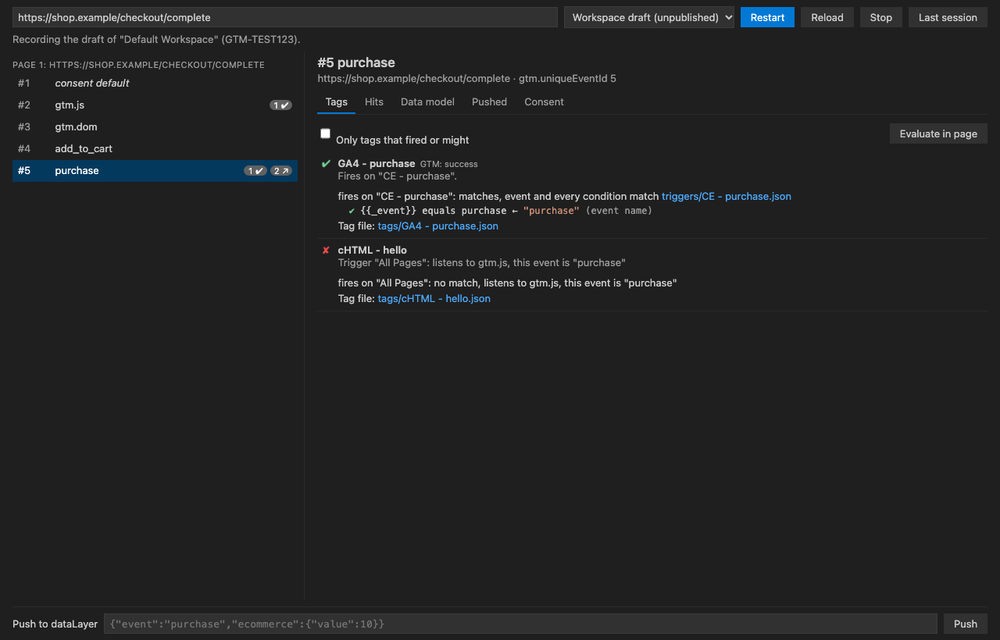

# GS Code

**Edit a Google Tag Manager workspace as plain files in VS Code. Bulk edit, diff, push to a workspace, and debug it in a real browser. Nothing goes live until you publish it.**

Free, MIT licensed, no account and no server. An independent project, not made by or affiliated with Google.

GS Code mirrors an entire GTM workspace (web or server-side) into a folder of plain files. You edit tags, triggers, variables and custom templates with everything VS Code is good at: search and replace across the whole container, multi-cursor, git, diffs, AI agents. Then you **Push** the changes back to GTM, check them in the **Debugger** against your real site before anything is published, and **Publish** when you are ready.


---

## The problem it solves

The GTM web UI is built for editing one thing at a time. Real tagging work rarely is:

- Renaming a parameter across 40 GA4 event tags means 40 trips through the same dialog.
- Finding every tag that reads `{{DL - user_id}}` has no real search.
- Reviewing what changed in a workspace before publishing is a click-by-click comparison.
- Custom HTML, Custom JavaScript variables and sandboxed template code are edited in a small text box with no tooling.
- Getting an AI assistant to help means copying JSON in and out, or giving it slow, opaque API access.

Container export / import helps a little, but the export is one giant JSON file full of numeric ids, and importing it back risks overwriting someone else's work.

And when a tag does not fire, GTM's preview tells you *that* it did not, not *why*.

**GS Code turns the workspace into a normal project folder.** One readable file per entity, references by name instead of id, real `.html` / `.js` files for code, a safe sync that never silently overwrites anyone, and a Source Control view that shows exactly what Push will send. Its debugger records what your page does and tells you which trigger file and which condition decided each tag.

## What it can touch

Before you point it at a real container:

- **Scopes requested:** `openid` and `email` (only to show which account is signed in), `tagmanager.readonly`, `tagmanager.edit.containers`, `tagmanager.edit.containerversions`, and `tagmanager.publish` only if publishing is enabled. Set `gsCode.allowPublish: false` and the publish scope is never requested.
- **Where pushes go:** into a GTM *workspace*, never the live container. Publishing is a separate command that makes you type the container id.
- **Where your tokens live:** your OS keychain (VS Code SecretStorage), or `~/.config/gs-code/` for the CLI, where `client.json` and `tokens.json` have file mode 600.
- **Who it talks to:** the Tag Manager API on `googleapis.com` and Google's OAuth endpoints, through your own OAuth client. The debugger drives a browser on your machine, and only sends requests to your own server container (a host you list in `gsCode.debug.sgtmHosts`) when you ask it to replay one. No server of mine, no analytics, no telemetry, no paid service anywhere.
- **Try it safely first:** set `allowPublish` to `false`, sign in, and open a new workspace on a test container. Pull and look around before you push anything. Any Google account can create a free test container at tagmanager.google.com in a minute.
- **For an IT or security review:** [SECURITY.md](SECURITY.md) lists everything GS Code stores, where, and what it sends. The code is MIT licensed and the CI runs in the open.

## What it does

| | |
| --- | --- |
| **Every entity is a file** | `tags/GA4 - purchase.json`, `triggers/CE - purchase.json`, `variables/cJS - page type.js`, `templates/Meta CAPI/code.js`, `clients/GA4.json` … Web and server containers, including clients, transformations, zones, Google tag configs, folders and built-in variables. |
| **Names, not ids** | `"firingTriggers": ["CE - purchase"]`, `"folder": "GA4"`, `"type": "template:Meta CAPI"`. Create a trigger and the tag that uses it in one go; ids are resolved for you on push. |
| **Real code files** | Custom HTML tags get a `.html` file, Custom JavaScript variables a `.js` file, custom templates are split into `code.js`, `parameters.json`, `permissions.json`, `info.json`, `tests.yaml`. |
| **Source Control view** | Every change listed, click for a side-by-side diff against GTM, M/A/D badges in the Explorer, inline change markers in the editor gutter. |
| **Validation before push** | Unknown triggers, folders or templates, duplicate names, broken JSON and files that cannot be read show up in the Problems panel, and block the push. |
| **Safe sync** | Pull is a three-way merge: untouched files update, your edits are kept, anything changed both locally and in GTM becomes a conflict you resolve (Keep Mine / Take Theirs). Push re-checks GTM first and refuses to overwrite a change someone made since your last pull. |
| **Fast pushes** | All changes go in one `workspaces.bulk_update` call (GTM allows only 0.25 API requests per second). |
| **Versions and publishing** | Create Version, or Create Version and Publish, with a typed container-id confirmation, a blocklist for containers you never want published from here, and a no-publish sign-in mode. |
| **Debugger** | Load your *unpublished* workspace on your real site, see every dataLayer event, tag status, consent state and network hit, and get the reason each tag fired or did not, linked to the file to fix. [More](docs/debugger.md) |
| **AI agents** | Every operation and the debugger are tools: Copilot uses them inside VS Code, Claude Code, Cursor and other MCP clients through `gscode mcp`. Agents can push to a workspace; only you can publish. |
| **Teams** | Share a mirror through git: each person links the same files to their own workspace (`--adopt`). Push and versioning check GTM again right before they write, and never overwrite a teammate's change. [More](docs/team.md) |
| **CLI** | `gscode` does everything the extension does, for scripts, CI and terminal AI agents. |

## Getting started

### 1. Install

- **VS Code, Cursor, VSCodium, Windsurf:** search for **GS Code** in Extensions (VS Code Marketplace and Open VSX), or download the `.vsix` from [Releases](https://github.com/Matthew-Klette/gs-code/releases) and run **Extensions: Install from VSIX…**.
- **CLI:** `npm install -g gs-code` (Node 20+), then `gscode --help`.

The first run opens a short walkthrough (**Help → Welcome → Get started with GS Code**).

### 2. Create a Google OAuth client (one time, about 10 minutes)

GS Code talks to the Tag Manager API with **your** Google account through **your own** OAuth client. No server in the middle, nobody else ever sees your tokens.

1. Open [Google Cloud Console](https://console.cloud.google.com/) and create a project (any name, e.g. `gs-code`).
2. **APIs & Services → Library** → enable **Tag Manager API**.
3. **Google Auth Platform → Branding / Audience**: app name of your choice, audience **External** (or **Internal** on Google Workspace), and add the Google account you use for GTM under **Test users**.
4. **Google Auth Platform → Clients → Create client** → application type **Desktop app** → **Download JSON**.

**Can't create a Cloud project?** Any project you already have works, for example the one your server-side GTM runs in: enable the Tag Manager API there and add a Desktop client. On Google Workspace, ask your admin for one **Internal** Desktop client and share it with the team (everyone signs in with their own account; the API quota of 25 requests per 100 seconds is shared per project).

**Why sign-in expires after 7 days:** Google expires refresh tokens weekly for External apps in **Testing** status. GS Code tells you when to sign in again. To stop it, use an **Internal** audience, or set the app's publishing status to **In production** (the unverified-app screen stays, because the app is yours and unreviewed).

### 3. Sign in

Command Palette (`⇧⌘P` / `Ctrl+Shift+P`) → **GS Code: Configure OAuth Client** → pick the downloaded JSON → **Sign In**.

Google shows "Google hasn't verified this app" because the app is yours and in testing mode; choose **Continue**. Credentials are stored in your OS keychain (VS Code SecretStorage). Once a mirror is open, the status bar tooltip shows which Google account is signed in.

Working over **Remote-SSH, WSL, a Dev Container or Codespaces**? Sign-in works there too. If the browser ends on a "can't connect" page, paste that page's address into the box GS Code shows. **Sign Out** revokes the sign-in at Google; **Remove OAuth Client** forgets the client as well.

### 4. Open a workspace

**GS Code: Open Workspace…** → account → container → workspace (or **Create new workspace…**) → a parent folder.

A folder named `GTM-XXXXXXX - Workspace name` is created and pulled. Open it; the **GS Code** panel appears in Source Control.

> Tip: create a dedicated GTM workspace for your session (e.g. `bulk-rename-oct`), exactly as you would in the GTM UI. GTM merges workspaces when you publish.

## Everyday use

| To | Do |
| --- | --- |
| See what you changed | Source Control view → **GS Code** |
| Compare a file with GTM | Click it in the Source Control view |
| Get changes made in GTM | Automatic (auto-pull checks every minute), or **Pull** (☁↓) to also bring the workspace up to a newly published version |
| Send your changes to GTM | **Push** (☁↑): shows the list and asks first |
| Throw away a change | ↶ next to the file, or **Discard Changes** |
| Settle a conflict | Right-click it → **Resolve Conflict: Keep Mine** / **Resolve Conflict: Take Theirs** |
| Test your changes on your site | **Open Debugger** (bug icon), enter a URL, **Start** |
| Make a version | `…` → **Create Version** |
| Go live | `…` → **Create Version and Publish** (type the container id to confirm) |
| Roll back | `…` → **Versions / Roll Back…** |
| Follow another workspace | `…` → **Switch Workspace…** (e.g. after a teammate versioned yours) |
| Jump to the GTM UI | `…` → **Open in Tag Manager** |

### Bulk edits

Use VS Code's search (`⇧⌘F`) across the folder. Examples:

- Replace `"value": "{{DL - user_id}}"` with `"value": "{{DL - customer_id}}"` everywhere.
- Regex-replace a measurement id across every GA4 tag.
- Multi-cursor through 30 trigger files at once.

Then look at the Source Control view: every touched entity is listed with its diff. Push sends them in one request.

### Adding things

Create a file in the right folder with at least `name` and `type` (copying an existing file is the quickest start). The content is the GTM API format with ids replaced by names:

```json
{
  "name": "GA4 - sign_up",
  "type": "gaawe",
  "firingTriggers": ["CE - sign_up"],
  "folder": "GA4",
  "parameter": [
    { "type": "template", "key": "eventName", "value": "sign_up" },
    { "type": "template", "key": "measurementIdOverride", "value": "G-XXXXXXXXXX" }
  ]
}
```

- **Folders** are listed in `folders.json`; add a name there to create one.
- **Built-in variables** are enabled in `built-in-variables.json`.
- **Custom templates** are folders under `templates/` with `template.json`, `info.json`, `parameters.json` and `code.js`.
- **Code** can live in its own file: `{ "type": "template", "key": "html", "valueFile": "My tag.html" }`.

Reference formats: a plain name for triggers and folders, `builtin:All Pages` for built-in triggers, `template:Name` for template-based types, `#123` for an id with no name locally.

### Renaming and deleting

- Change `name` inside a file to rename the entity in GTM (the file name doesn't matter).
- Rename only the file and the entity stays the same.
- Delete the file to delete the entity.
- When you rename a trigger or folder, update its references too (one search and replace); validation tells you if you missed one.
- Renamed something in the GTM UI? **Rename Files to Match GTM** (`gscode tidy`) renames the files too.

Files copied from a container export are fine: export-style spellings like `TEMPLATE` or `TRIGGER_REFERENCE` are converted on push. The full format is in [docs/file-format.md](docs/file-format.md).

### Debugging



**GS Code: Open Debugger** → enter your site's URL → **Start**. GS Code opens your own Chrome, Edge, Brave or Chromium (it never downloads one) and, in **Workspace draft** mode, loads your *unpublished* workspace on the real site, for you only. Then:

- every dataLayer event, with what was pushed and the data model after it;
- each tag's status as GTM reports it, and for every tag **why** it fired or not: the trigger, each condition with the value it compared, blocking triggers, consent, pause and schedule, with links to the files;
- consent state per event and every measurement hit (GA4, Google Ads, Meta, server container…) with its parameters;
- server containers: requests to your sGTM with the client predicted to claim them, and a replay into your own sGTM preview (only to the hosts in `gsCode.debug.sgtmHosts`; replayed requests run your server container's tags for real).

Fix a file, Push, press **Reload**: the draft picks up the change. Details and settings: [docs/debugger.md](docs/debugger.md).

### Using it with an AI assistant

The workspace is just files, so any coding agent can read and edit it. GS Code also gives agents tools to check their work in the real world:

- **Copilot (agent mode) in VS Code:** the tools are built in (`#debug_start`, `#debug_explain`, `#gtm_status`, …) and share the Debugger panel's session.
- **Claude Code, Cursor and other MCP clients:** `claude mcp add gscode -- gscode mcp` (run it in the mirror folder, or pass `--dir`).

A typical loop: *"Why doesn't GA4 - purchase fire on the thank-you page?"* → the agent starts a session, reads the explanation, edits the trigger file, checks `gtm_status`, pushes to the workspace and reloads to confirm. Agents cannot create versions or publish.

## Safety

GS Code is designed so that nothing reaches GTM, and nothing goes live, without you seeing it first.

- **Push** always shows the full list of changes and asks before sending. It goes to a **workspace**, never live.
- **Conflicts** are detected with GTM's own fingerprints. If anyone changed an entity in GTM since your last pull, Push stops.
- **Publish** needs you to type the container's public id (`GTM-XXXXXXX`) every time.
- **`gsCode.protectedContainers`** blocks Create Version and Publish for the containers you list (Pull and Push still work). It is read from your *User* settings only, so a shared folder cannot change it.
- **`gsCode.allowPublish: false`** + sign in again = a token that physically cannot publish (the `tagmanager.publish` scope is never requested). Also User settings only.
- **Restricted Mode.** In a folder you have not trusted, GS Code only shows and pulls. Push, Create Version, Publish, Versions / Roll Back, starting the debug browser and the agent tools `gtm_push`, `debug_start` and `debug_replay_sgtm` are refused until you trust the folder.
- **Push sends exactly what you confirmed.** If an editor, an agent or another window changes a file between your confirmation and the push, nothing is sent.
- **Versions contain exactly what you reviewed.** Create Version re-checks GTM first and refuses if the workspace changed since your last pull. Publishing never rolls back a newer live version unless you choose Roll Back.
- **Background checks never write to GTM.** A newly published version is announced; the workspace is only updated when you Pull.
- **One process at a time per folder.** The CLI, VS Code windows and agents take turns (`.gtm/lock`), and an interrupted push loses nothing: the next pull finishes it.
- **Your data stays local.** The mirror folder, your OAuth client and tokens never leave your machine except in calls to Google's Tag Manager API.

## Settings

All settings live under `gsCode.*` in VS Code settings. Some can only be set in certain places:

- `allowPublish` and `protectedContainers` are read from your *User* settings only. A value in a shared repo's `.vscode/settings.json` is ignored, so each person sets their own.
- `debug.browserPath` and `debug.browserUrl` are machine settings: set them in User settings (or the remote's settings when working remotely). Workspace values are ignored.
- In Restricted Mode (an untrusted folder) a workspace value of `debug.sgtmHosts` is ignored until you trust the folder.

| Setting | Type | Default | What it does |
| --- | --- | --- | --- |
| `gsCode.protectedContainers` | string[] | `[]` | Public ids (`GTM-XXXXXXX`) where Create Version and Publish are blocked. Pull and Push still work. User settings only. |
| `gsCode.allowPublish` | boolean | `true` | Requests the `tagmanager.publish` scope at sign-in and enables the **Create Version and Publish** command and publishing from **Versions / Roll Back**. **Create Version** alone always works. Set it to `false` and sign in again for a token that cannot publish at all. User settings only. |
| `gsCode.pushStrategy` | `bulk` \| `sequential` | `bulk` | `bulk` sends every change in one `workspaces.bulk_update` call. `sequential` uses one API call per entity: much slower under the quota, but errors are reported per entity. |
| `gsCode.autoPull.enabled` | boolean | `true` | Checks GTM for changes on a timer, when the window gets focus and when a mirror opens, and pulls when something changed. Never sends anything to GTM and never overwrites unpushed or unsaved edits. |
| `gsCode.autoPull.intervalSeconds` | number | `60` | Seconds between background checks (minimum 15). A check is 2 requests; at 60 s that is about 3 of the 25 requests per 100 s. |
| `gsCode.debug.browserUrl` | string | `""` | Attach the debugger to a Chromium-based browser already running with `--remote-debugging-port`, e.g. `http://127.0.0.1:9222`. Empty: GS Code launches your installed Chrome, Edge, Brave or Chromium with its own profile. Machine setting (User or remote settings). |
| `gsCode.debug.browserPath` | string | `""` | Path of the browser to launch. Empty: the first one found. Machine setting (User or remote settings). |
| `gsCode.debug.sgtmHosts` | string[] | `[]` | Hosts of your server-side GTM (e.g. `sgtm.example.com`). Requests to these hosts, and their subdomains, are recorded as server-container hits. Replay into sGTM preview only sends to these hosts, and needs at least one. |
| `gsCode.debug.loaderPatterns` | string[] | `[]` | URL patterns (with `*`) of a custom `gtm.js` loader, such as a first-party loader on your own domain. In Workspace draft mode these requests are redirected to the draft on googletagmanager.com. |
| `gsCode.debug.dataLayerName` | string | `dataLayer` | Name of the page's data layer array, if it is not `dataLayer`. |
| `gsCode.debug.tagStatus` | boolean | `true` | Reads each tag's status per event by adding an `eventCallback` to dataLayer events (the site's own callback still runs). Turn it off if a site's code is sensitive to that. Applies to sessions started from the Debugger panel; sessions started by an agent tool always read tag status. |

The CLI does not read VS Code settings. It uses `~/.config/gs-code/config.json` (`protectedContainers`, `allowPublish`) and the environment variables below. `loaderPatterns`, `dataLayerName` and `tagStatus` have no CLI equivalent yet.

## CLI

```sh
npm install -g gs-code      # Node 20+, puts `gscode` on your PATH
gscode --help
```

A typical session:

```sh
gscode login --client ~/Downloads/client_secret_XXXX.json
gscode accounts
gscode containers <accountId>
gscode init ./my-container --account <id> --container GTM-XXXXXXX --workspace "my changes" --create
cd my-container
gscode status
gscode pull
gscode push                 # shows the changes and asks; --yes (-y) to skip the question
gscode version --name "v42" --notes "…"                          # create a version
gscode version --name "v42" --publish --confirm GTM-XXXXXXX      # create and publish
```

`[dir]` defaults to the current folder. Commands that take `--dir` use it instead of a positional folder.

**Sign-in and browsing**

| Command | What it does |
| --- | --- |
| `gscode login [--client <client_secret.json>] [--no-publish] [--manual]` | Saves the OAuth client (first time) and signs in through your browser. `--no-publish` asks for a token without the publish scope. `--manual` prints the address to open on any machine and asks you to paste the final `http://127.0.0.1:…` address back; it is used automatically over SSH, in Codespaces and dev containers, and on Linux with no display. |
| `gscode logout [--forget-client]` | Revokes the sign-in at Google and deletes the tokens. `--forget-client` also removes the OAuth client. |
| `gscode whoami` | Which Google account is signed in and whether it can publish (or which CI credential is in use). |
| `gscode accounts` | Lists GTM accounts: id and name. |
| `gscode containers <accountId>` | Lists containers: public id, numeric id, usage context, name. |
| `gscode workspaces <accountId> <GTM-XXXXXXX\|containerId>` | Lists workspaces of a container. |

**Mirror and sync**

| Command | What it does |
| --- | --- |
| `gscode init <dir> --account <id> --container <GTM-XXXXXXX\|id> --workspace <name\|id> [--create] [--adopt]` | Creates a mirror of the workspace in `<dir>` and pulls it. `--create` creates the workspace if no workspace has that name. `--adopt` keeps mirror files already in the folder (a teammate's git clone) and links them to your workspace; without it the folder must be empty. |
| `gscode status [dir]` | Last pull, conflicts, validation problems and the changes Push would send. Exits with code 1 when a push would be blocked (parse errors, validation errors, conflicts or GTM merge conflicts); warnings and pending changes exit 0. |
| `gscode pull [dir] [--no-sync]` | Brings the workspace up to the latest container version if it is behind (`workspaces.sync`), then pulls with a three-way merge. `--no-sync` pulls without updating the workspace. |
| `gscode watch [dir] [--interval <seconds>] [--verbose]` | Keeps pulling GTM changes as they happen (default every 60 s, minimum 15). Never syncs the workspace or pushes. `--verbose` (`-v`) also prints checks that found nothing. Ctrl+C stops. |
| `gscode push [dir] [--sequential] [--yes]` | Pulls first, stops on any conflict, shows the change list and asks, then pushes to the workspace. `--sequential` sends one call per entity. |
| `gscode discard [dir] [--path <base>]...` | Throws local changes away. With `--path` (repeatable) only those files; without it, every change. |
| `gscode resolve <base> (--mine \| --theirs) [--dir dir]` | Settles a local/GTM conflict on one file: keep your version or take GTM's. |
| `gscode resolve-gtm <base> (--keep-workspace \| --latest) [--dir dir]` | Settles a GTM merge conflict between this workspace and a newer container version, then pulls. |
| `gscode switch [dir] (--workspace <name\|id> \| --new <name>)` | Points the mirror at another workspace (after yours was versioned or deleted), or at a new one. Working files are backed up to `.gtm/backups/` first. |
| `gscode tidy [dir]` | Renames files to match their names in GTM. |

**Versions and publishing**

| Command | What it does |
| --- | --- |
| `gscode version [dir] --name <name> [--notes <text>] [--publish --confirm <GTM-XXXXXXX>]` | Pulls (without syncing), then creates a version from the workspace. Refuses with unpushed changes. With `--publish` it also publishes, and `--confirm` must repeat the container's public id. Blocked for protected containers. |
| `gscode publish [dir] --version <id> --confirm <GTM-XXXXXXX> [--rollback]` | Publishes an existing version. Publishing a version older than the live one needs `--rollback`. |
| `gscode versions [dir]` | Lists container versions; `*` marks the live one. |
| `gscode environments [dir]` | Lists environments (live, latest, workspace previews and your own). |

**Debugger and agents**

| Command | What it does |
| --- | --- |
| `gscode debug <url> [--dir dir] [--live] [--tab <url prefix>]` | Records the page in the debug browser: events, tags, consent, hits. Default is your unpublished workspace; `--live` uses the published container. `--tab` attaches to an open tab whose address starts with the prefix. While it runs: Enter reloads, `e <seq>` explains an event, `q` quits. Sessions are saved in `.gtm/debug/`. |
| `gscode explain <seq> [tag] [--dir dir]` | Why tags fired or not on a recorded event of the latest session. |
| `gscode mcp [--dir dir]` | MCP server on stdin/stdout for AI agents: `claude mcp add gscode -- gscode mcp`. |
| `gscode replay-sgtm --header <X-Gtm-Server-Preview> [--name <event>] [--dir dir]` | Re-sends captured server-container requests into your sGTM preview. The header value comes from "Send requests manually" in sGTM preview. `--name` sends only the hits for that event name; without it, every captured server-container request is replayed. It uses the latest recorded session and needs `GSCODE_SGTM_HOSTS`: only requests to those hosts (and their subdomains) are sent, over https (plain http only for a listed `localhost` or `127.0.0.1`), GET or POST only. The requests are real: your server container's tags run and vendors receive them, so replaying a purchase can record a duplicate conversion. |
| `gscode sgtm-local --config <CONTAINER_CONFIG> [--port 8080] [--preview-port 8081]` | Runs your server container locally in Docker with Google's official image, plus a preview server. Both ports are published on `127.0.0.1` only, must be 1 to 65535 and must differ. The two containers share a Docker network named `gscode-sgtm`, which is created on first use and left in place after Ctrl+C (remove it with `docker network rm gscode-sgtm`). Works with Docker Desktop and native Linux Docker. Tags that fire send real requests to vendors, so use test ids. |

Any other command, or none, prints the help.

### Configuration and environment variables

The CLI keeps its OAuth client, tokens, rate-limit history and debug browser profile in its config folder. The folder is created with mode 700, and `client.json`, `tokens.json` and `ratelimit.json` are written with mode 600.

| Variable | What it does |
| --- | --- |
| `GSCODE_CONFIG_DIR` | Config folder. Default `$XDG_CONFIG_HOME/gs-code`, else `~/.config/gs-code`. |
| `GSCODE_PROTECTED` | Comma-separated public ids added to `protectedContainers` from `config.json`, e.g. `GSCODE_PROTECTED=GTM-XXXXXXX,GTM-YYYYYYY`. |
| `GSCODE_AUTH=adc` | Uses Application Default Credentials instead of a browser sign-in: a service-account key file in `GOOGLE_APPLICATION_CREDENTIALS`, workload identity federation, or `gcloud auth application-default login`. Add the service account's email as a user in GTM. |
| `GSCODE_ALLOW_PUBLISH=1` | With `GSCODE_AUTH=adc` only: also requests the publish scope. Without it, ADC tokens cannot publish. |
| `GSCODE_ACCESS_TOKEN` | Uses this access token as is (for example one minted by an earlier CI step). Takes precedence over `GSCODE_AUTH`. |
| `GSCODE_BROWSER_URL` | Debugger: attach to a running Chromium-based browser, e.g. `http://127.0.0.1:9222`. |
| `GSCODE_BROWSER_PATH` | Debugger: the browser executable to launch. |
| `GSCODE_SGTM_HOSTS` | Debugger: comma-separated server-container hosts, e.g. `sgtm.example.com`. Required for `replay-sgtm` and the MCP `debug_replay_sgtm` tool, which only send to these hosts. There is no `config.json` equivalent. |

`config.json` example: `{"protectedContainers": ["GTM-XXXXXXX"], "allowPublish": false}`. With `allowPublish: false`, `gscode login` never requests the publish scope.

Running it in CI (GitHub Actions and others) is covered in [docs/ci.md](docs/ci.md).

## How it works

```
GTM-XXXXXXX - my changes/
  tags/  triggers/  variables/  templates/  clients/  transformations/  zones/  gtag-configs/
  folders.json
  built-in-variables.json
  .gitignore           ignores .gtm/ (written by init if there was none)
  .gtm/
    state.json   container, workspace, ids and fingerprints of everything pulled, conflicts, last GTM status
    base/        the last pulled copy (the left side of every diff)
    remote/      GTM's copy of anything in conflict with your edits
    merge/       the latest container version's copy of anything in a GTM merge conflict
    debug/       recorded debugger sessions (.jsonl)
    backups/     copies of your working files taken before Switch Workspace
    lock         present while a process is pulling, pushing or versioning
```

`.gtm/` is per person and per workspace: never commit it, and don't edit it by hand. The entity files are what a team shares ([docs/team.md](docs/team.md)). The file format is in [docs/file-format.md](docs/file-format.md).

- **Checking for changes** costs 2 requests: the workspace status and the latest version header. If neither moved since the last pull, nothing else is fetched.
- **Pull** lists every entity type and the built-in variables (about 8 list requests for a web container, 10 for a server container), renders them as files and merges three ways against `.gtm/base`: untouched files update, your edits stay, and anything changed on both sides becomes a conflict with GTM's copy in `.gtm/remote/`. An explicit Pull also brings the workspace up to a newer published version first (`workspaces.sync`); GTM's own merge conflicts are recorded, with the latest version's copy in `.gtm/merge/`, and never resolved for you.
- **Push** checks GTM (2 requests), stops on any conflict, and checks that the files still match what you confirmed. If GTM is unchanged it fetches only what the push needs instead of a full snapshot. It reads the workspace status once more right before writing and stops if anything moved, sends one `bulk_update`, then re-reads only the entity types it touched. A one-tag edit costs about 9 to 10 requests in total. What was sent is recorded in `state.json` before the refresh, so if the refresh fails the next pull finishes the job and nothing is lost.
- **Create Version** refuses while you have unpushed changes, while a newer published version has not been pulled in, or if GTM's workspace status changed since your last pull. Then it turns the workspace into a container version. GTM replaces the workspace and GS Code follows the new one. If that fails (free accounts allow 3 workspaces), use Switch Workspace.
- **Auto-pull** checks every 60 s by default (minimum 15), plus on window focus and when a mirror opens. After 10 checks in a row with nothing new the interval doubles, up to 4 times the setting; any change, focus or command resets it. Each delay has ±10% jitter so teammates' mirrors do not poll in step. Failed checks back off exponentially up to 10 minutes. Being signed out, a deleted workspace or the daily quota stop it until you act. Auto-pull never syncs the workspace to a newer version or writes to GTM; it tells you a version was published.
- **Lock.** Pull, Push, Create Version, Switch Workspace and tidy take `.gtm/lock`, so the CLI, `gscode watch`, several VS Code windows and agents never write the same mirror at once. Others wait up to 30 s; a background check skips its turn instead of waiting. The process holding the lock refreshes it every 60 s, so a long push is never taken for a crash. A lock not refreshed for 15 minutes, or held by a process that no longer exists on this machine, is cleared. An empty or unreadable lock (left by a crash mid-write) is cleared once it is about 5 s old. Each lock carries a random token, and a process only ever removes its own. Short-lived `.gtm/lock.<id>.tmp` and `.gtm/lock.guard` files can appear while the lock changes hands.
- **Quota.** The Tag Manager API allows 25 requests per 100 seconds per Google Cloud project. GS Code paces itself with a sliding window whose request history the CLI and the extension share (`ratelimit.json` in the CLI config folder) and retries with backoff on quota errors.

> **Keep mirrors of real containers out of public repos.** A mirror folder contains your container's full configuration. If you version it with git, use a private repository.

How the debugger is built: [docs/debugger-design.md](docs/debugger-design.md).

## Limitations

- **Desktop VS Code only.** The extension runs in the workspace extension host, so it does not work in vscode.dev or github.dev. Remote-SSH, WSL, Dev Containers and Codespaces work.
- **Web and server containers only.** Mobile (Android / iOS) and AMP containers are refused.
- One mirror folder per GTM workspace.
- Google tag (gtag) configs have no name, so their files are named by id.
- Zones are only available on GTM 360 accounts.
- **Windows:** file mode 600 on the CLI's credential files does nothing, so they are protected only by your user profile's permissions. File names are capped at 120 bytes, but deep folders can still exceed the 260-character path limit; keep mirrors near the drive root or enable long paths.
- **Server-side preview:** GS Code cannot read sGTM preview internals. It predicts which client claims a request and can replay requests into your own sGTM preview, where you see the result. Replay needs your sGTM hosts configured and sends real requests (tags run, vendors receive them). A GA4 hit to some other non-Google host is still marked `(1p)` but is not replayed.
- **Debugger URLs:** only `http://` and `https://` pages (and `about:blank`) can be debugged; `file:`, `chrome:` and other schemes are refused.
- **Offline explanations:** trigger conditions using `cssSelector` (and other element matches) are not evaluated; the explanation says they are unknown.
- **Variables read "now":** Custom JavaScript, JavaScript variable, cookie and DOM element variables are evaluated in the page when you ask, not at the time of the event, so their values can differ from what GTM saw.

More on the debugger's limits in [docs/debugger.md](docs/debugger.md). If something goes wrong, see [docs/troubleshooting.md](docs/troubleshooting.md).

## More

- [docs/debugger.md](docs/debugger.md): using the debugger
- [docs/team.md](docs/team.md): sharing a mirror through git
- [docs/ci.md](docs/ci.md): running the CLI in CI
- [docs/file-format.md](docs/file-format.md): the file format
- [docs/troubleshooting.md](docs/troubleshooting.md): common problems
- [docs/debugger-design.md](docs/debugger-design.md): how the debugger works inside
- [SECURITY.md](SECURITY.md): what GS Code stores and sends, and how to report a vulnerability
- [CONTRIBUTING.md](CONTRIBUTING.md): working on GS Code
- [CHANGELOG.md](CHANGELOG.md): what changed

## Development

```sh
npm install
npm test                 # unit + lifecycle tests against an in-memory GTM
npm run test:extension   # runs the extension inside VS Code
npm run build            # dist/extension.js + dist/cli.js
npm run package          # builds a .vsix you can install with "Extensions: Install from VSIX…"
```

Press `F5` in VS Code to launch an Extension Development Host.

## License

MIT © Matthew Klette

GS Code is an independent open-source project. It is not affiliated with, endorsed by or sponsored by Google. Google Tag Manager is a trademark of Google LLC.
