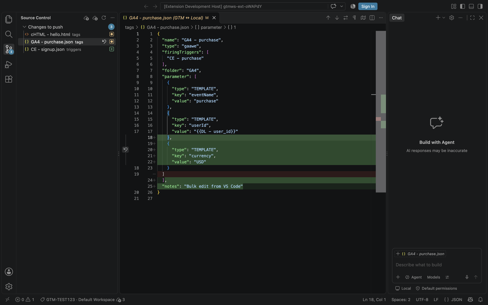

# GS Code

**Edit a Google Tag Manager workspace as plain files in VS Code. Bulk edit, diff, push to a workspace. Nothing goes live until you publish it.**

Free, MIT licensed, no account and no server. An independent project, not made by or affiliated with Google.

GS Code mirrors an entire GTM workspace (web or server-side) into a folder of plain files. You edit tags, triggers, variables and custom templates with everything VS Code is good at — search and replace across the whole container, multi-cursor, git, diffs, AI agents — then **Push** the changes back to GTM and **Publish** when you are ready.



---

## The problem it solves

The GTM web UI is built for editing one thing at a time. Real tagging work rarely is:

- Renaming a parameter across 40 GA4 event tags means 40 trips through the same dialog.
- Finding every tag that reads `{{DL - user_id}}` has no real search.
- Reviewing what changed in a workspace before publishing is a click-by-click comparison.
- Custom HTML, Custom JavaScript variables and sandboxed template code are edited in a small text box with no tooling.
- Getting an AI assistant to help means copying JSON in and out, or giving it slow, opaque API access.

Container export / import helps a little, but the export is one giant JSON file full of numeric ids, and importing it back risks overwriting someone else's work.

**GS Code turns the workspace into a normal project folder.** One readable file per entity, references by name instead of id, real `.html` / `.js` files for code, a safe sync that never silently overwrites anyone, and a Source Control view that shows exactly what Push will send.

## What it can touch

Before you point it at a real container:

- **Scopes requested:** `tagmanager.readonly`, `tagmanager.edit.containers`, `tagmanager.edit.containerversions`, and `tagmanager.publish` only if publishing is enabled. Set `gsCode.allowPublish: false` and the publish scope is never requested.
- **Where pushes go:** into a GTM *workspace*, never the live container. Publishing is a separate command that makes you type the container id.
- **Where your tokens live:** your OS keychain (VS Code SecretStorage), or `~/.config/gs-code/` with file mode 600 for the CLI.
- **Who it talks to:** only `googleapis.com`, through your own OAuth client. No server of mine, no analytics, no telemetry. The only runtime dependency is Google's `google-auth-library`.
- **Try it safely first:** set `allowPublish` to `false`, sign in, and open a new workspace on a test container. Pull and look around before you push anything.

## What it does

| | |
| --- | --- |
| **Every entity is a file** | `tags/GA4 - purchase.json`, `triggers/CE - purchase.json`, `variables/cJS - page type.js`, `templates/Meta CAPI/code.js`, `clients/GA4.json` … Web and server containers, including clients, transformations, zones, Google tag configs, folders and built-in variables. |
| **Names, not ids** | `"firingTriggers": ["CE - purchase"]`, `"folder": "GA4"`, `"type": "template:Meta CAPI"`. Create a trigger and the tag that uses it in one go; ids are resolved for you on push. |
| **Real code files** | Custom HTML tags get a `.html` file, Custom JavaScript variables a `.js` file, custom templates are split into `code.js`, `parameters.json`, `permissions.json`, `info.json`, `tests.yaml`. |
| **Source Control view** | Every change listed, click for a side-by-side diff against GTM, M/A/D badges in the Explorer, inline change markers in the editor gutter. |
| **Validation before push** | Unknown triggers, folders or templates, duplicate names and broken JSON show up in the Problems panel, and block the push. |
| **Safe sync** | Pull is a three-way merge: untouched files update, your edits are kept, anything changed both locally and in GTM becomes a conflict you resolve (Keep Mine / Take Theirs). Push re-checks GTM first and refuses to overwrite a change someone made since your last pull. |
| **Fast pushes** | All changes go in one `workspaces.bulk_update` call (GTM allows only 0.25 API requests per second). |
| **Versions and publishing** | Create Version, or Create Version and Publish, with a typed container-id confirmation, a blocklist for containers you never want published from here, and a no-publish sign-in mode. |
| **CLI** | `gscode` does everything the extension does, for scripts, CI and terminal AI agents. |

## Getting started

### 1. Install

GS Code is not on the VS Code Marketplace yet. Download `gs-code-0.1.0.vsix` from [Releases](https://github.com/Matthew-Klette/gs-code/releases), then in VS Code run **Extensions: Install from VSIX…** and pick the file. (Or build it yourself, see [Development](#development).)

### 2. Create a Google OAuth client (one time, about 10 minutes)

GS Code talks to the Tag Manager API with **your** Google account through **your own** OAuth client. No server in the middle, nobody else ever sees your tokens.

1. Open [Google Cloud Console](https://console.cloud.google.com/) and create a project (any name, e.g. `gs-code`).
2. **APIs & Services → Library** → enable **Tag Manager API**.
3. **Google Auth Platform → Branding / Audience**: app name of your choice, audience **External** (or **Internal** on Google Workspace), and add the Google account you use for GTM under **Test users**.
4. **Google Auth Platform → Clients → Create client** → application type **Desktop app** → **Download JSON**.

**Can't create a Cloud project?** Any project you already have works, for example the one your server-side GTM runs in: enable the Tag Manager API there and add a Desktop client. On Google Workspace, ask your admin for one **Internal** Desktop client and share it with the team (everyone signs in with their own account; the API quota of 25 requests per 100 seconds is shared per project).

**Why sign-in expires after 7 days:** Google expires refresh tokens weekly for External apps in **Testing** status. GS Code tells you when to sign in again. To stop it, use an **Internal** audience, or set the app's publishing status to **In production** (the unverified-app screen stays, because the app is yours and unreviewed).

### 3. Sign in

Command Palette (`⇧⌘P` / `Ctrl+Shift+P`) → **GS Code: Configure OAuth Client** → pick the downloaded JSON → **Sign In**.

Google shows "Google hasn't verified this app" because the app is yours and in testing mode; choose **Continue**. Credentials are stored in your OS keychain (VS Code SecretStorage).

### 4. Open a workspace

**GS Code: Open Workspace…** → account → container → workspace (or **Create new workspace…**) → a parent folder.

A folder named `GTM-XXXXXXX - Workspace name` is created and pulled. Open it; the **GS Code** panel appears in Source Control.

> Tip: create a dedicated GTM workspace for your session (e.g. `bulk-rename-oct`), exactly as you would in the GTM UI. GTM merges workspaces when you publish.

## Everyday use

| To | Do |
| --- | --- |
| See what you changed | Source Control view → **GS Code** |
| Compare a file with GTM | Click it in the Source Control view |
| Get changes made in GTM | **Pull** (☁↓ in the Source Control title bar) |
| Send your changes to GTM | **Push** (☁↑) – shows the list and asks first |
| Throw away a change | ↶ next to the file, or **Discard Changes** |
| Settle a conflict | Right-click it → **Keep Mine** / **Take Theirs** |
| Make a version | `…` → **Create Version** |
| Go live | `…` → **Create Version and Publish** (type the container id to confirm) |
| Jump to the GTM UI | `…` → **Open in Tag Manager** |

### Bulk edits

Use VS Code's search (`⇧⌘F`) across the folder. Examples:

- Replace `"value": "{{DL - user_id}}"` with `"value": "{{DL - customer_id}}"` everywhere.
- Regex-replace a measurement id across every GA4 tag.
- Multi-cursor through 30 trigger files at once.

Then look at the Source Control view: every touched entity is listed with its diff. Push sends them in one request.

### Adding things

Create a file in the right folder with at least `name` and `type` (copying an existing file is the quickest start). The content is the GTM API format with ids replaced by names:

```json
{
  "name": "GA4 - sign_up",
  "type": "gaawe",
  "firingTriggers": ["CE - sign_up"],
  "folder": "GA4",
  "parameter": [
    { "type": "template", "key": "eventName", "value": "sign_up" },
    { "type": "template", "key": "measurementIdOverride", "value": "G-XXXXXXXXXX" }
  ]
}
```

- **Folders** are listed in `folders.json`; add a name there to create one.
- **Built-in variables** are enabled in `built-in-variables.json`.
- **Custom templates** are folders under `templates/` with `template.json`, `info.json`, `parameters.json` and `code.js`.
- **Code** can live in its own file: `{ "type": "template", "key": "html", "valueFile": "My tag.html" }`.

Reference formats: a plain name for triggers and folders, `builtin:All Pages` for built-in triggers, `template:Name` for template-based types, `#123` for an id with no name locally.

### Renaming and deleting

- Change `name` inside a file to rename the entity in GTM (the file name doesn't matter).
- Rename only the file and the entity stays the same.
- Delete the file to delete the entity.
- When you rename a trigger or folder, update its references too — one search and replace — and validation will tell you if you missed one.

### Using it with an AI assistant

Because the workspace is just files, any coding agent (Claude Code, Copilot, Cursor …) can read and edit it directly — no GTM API access needed by the agent. Review its changes in the Source Control view, then Push yourself. With the CLI, an agent can also run `gscode status` to check its work.

## Safety

GS Code is designed so that nothing reaches GTM, and nothing goes live, without you seeing it first.

- **Push** always shows the full list of changes and asks before sending. It goes to a **workspace**, never live.
- **Conflicts** are detected with GTM's own fingerprints. If anyone changed an entity in GTM since your last pull, Push stops.
- **Publish** needs you to type the container's public id (`GTM-XXXXXXX`) every time.
- **`gsCode.protectedContainers`** blocks Create Version and Publish for the containers you list (Pull and Push still work). Keep it in your *User* settings.
- **`gsCode.allowPublish: false`** + sign in again = a token that physically cannot publish (the `tagmanager.publish` scope is never requested).
- **Your data stays local.** The mirror folder, your OAuth client and tokens never leave your machine except in calls to Google's Tag Manager API.

## Settings

| Setting | Default | |
| --- | --- | --- |
| `gsCode.protectedContainers` | `[]` | Public ids (`GTM-XXXXXXX`) where Create Version and Publish are blocked. |
| `gsCode.allowPublish` | `true` | `false` hides Publish and, after signing in again, requests a token without the publish scope. |
| `gsCode.pushStrategy` | `bulk` | `sequential` pushes one entity per API call: slower, but errors are reported per entity. |

## CLI

```sh
git clone https://github.com/Matthew-Klette/gs-code.git && cd gs-code
npm install && npm run build && npm link      # puts `gscode` on your PATH

gscode login --client ~/Downloads/client_secret_XXXX.json
gscode accounts
gscode containers <accountId>
gscode init ./my-container --account <id> --container GTM-XXXXXXX --workspace "my changes" --create
cd my-container
gscode status
gscode pull
gscode push                 # shows the changes and asks; --yes to skip
gscode version --name "v42" --notes "…"                          # create a version
gscode version --name "v42" --publish --confirm GTM-XXXXXXX      # create and publish
```

The CLI stores credentials in `~/.config/gs-code/` (file mode 600). Protected containers: `~/.config/gs-code/config.json` → `{"protectedContainers": ["GTM-XXXXXXX"]}`, or `GSCODE_PROTECTED=GTM-A,GTM-B`.

## How it works

```
GTM-XXXXXXX - my changes/
  tags/  triggers/  variables/  templates/  clients/  transformations/  zones/  gtag-configs/
  folders.json
  built-in-variables.json
  .gtm/
    state.json   ids + fingerprints of everything pulled
    base/        the last pulled copy (the left side of every diff)
    remote/      GTM's copy of anything in conflict
```

- **Pull** reads every entity (about 10 API calls), renders it as files and merges three ways against `.gtm/base`.
- **Push** diffs your files against `.gtm/base`, validates references, re-reads GTM to check fingerprints, sends one bulk update, then pulls again so ids and fingerprints are current. If a push fails, nothing is half-applied: whatever didn't go through stays as a local change.
- **Create Version** turns the workspace into a container version. GTM then deletes that workspace and starts a fresh one; GS Code follows it automatically.
- The Tag Manager API allows 25 requests per 100 seconds per Google Cloud project. GS Code rate-limits itself (shared across CLI runs) and backs off on quota errors.

> **Keep mirrors of real containers out of public repos.** A mirror folder contains your container's full configuration. If you version it with git, use a private repository.

## Limitations

- One mirror folder per GTM workspace.
- Google tag (gtag) configs have no name, so their files are named by type and id.
- Zones are only available on GTM 360 accounts.
- Mobile (Android / iOS) containers are not supported.

## Development

```sh
npm install
npm test                 # unit + lifecycle tests against an in-memory GTM
npm run test:extension   # runs the extension inside VS Code
npm run build            # dist/extension.js + dist/cli.js
npm run package          # builds a .vsix you can install with "Extensions: Install from VSIX…"
```

Press `F5` in VS Code to launch an Extension Development Host.

## License

MIT © Matthew Klette

GS Code is an independent open-source project. It is not affiliated with, endorsed by or sponsored by Google. Google Tag Manager is a trademark of Google LLC.
